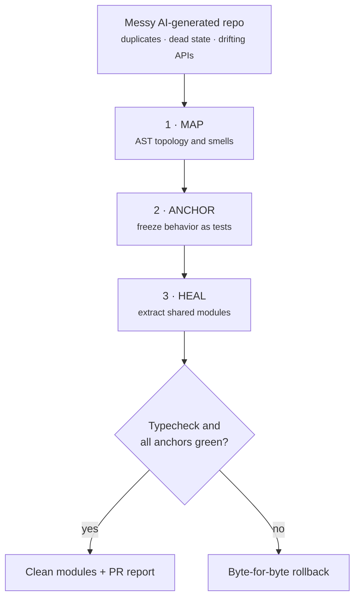
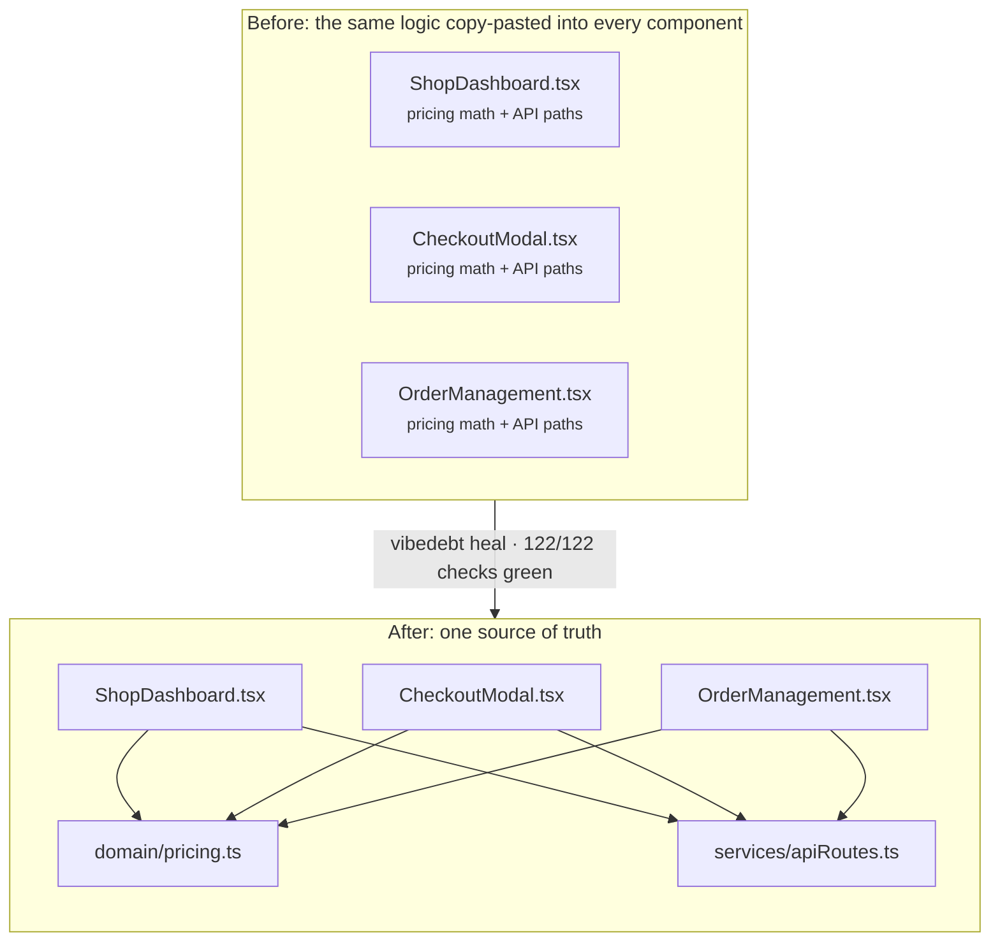

# VibeDebt

> **Refactor vibe-coded apps without breaking them.**

VibeDebt provides a deterministic safety net for AI-assisted refactoring. It analyzes AST topology to detect duplicated math, orphaned state, divergent APIs, and catch blocks with no statements. It synthesizes black-box behavioral characterization tests before touching any code and executes atomic extractions under an automatic byte-for-byte rollback guard.

[](https://github.com/tamilselvan04200803-max/vibedebt/actions/workflows/ci.yml)
[](https://github.com/tamilselvan04200803-max/vibedebt/actions/workflows/ci.yml)
[](https://nodejs.org)
[](https://www.typescriptlang.org)
[](LICENSE)

<details>
<summary>ASCII Art Banner</summary>

```text
 __      ___ _          _____       _     _   
 \ \    / (_) |        |  __ \     | |   | |  
  \ \  / / _| |__   ___| |  | | ___| |__ | |_ 
   \ \/ / | | '_ \ / _ \ |  | |/ _ \ '_ \| __|
    \  /  | | |_) |  __/ |__| |  __/ |_) | |_ 
     \/   |_|_.__/ \___|_____/ \___|_.__/ \__|
```
</details>

<p align="center">
  
</p>



---

## 👥 Who Is This For?

- **Developers using Cursor, Claude Code, Copilot, or Antigravity** who now inherit monolithic components, copy-pasted calculation loops, and fragmented state.
- **Engineering teams** that want AI refactors gated by hard behavioral evidence rather than probabilistic reviews.
- **Open-source maintainers** cleaning up AI-assisted pull requests without introducing subtle regressions.

---

## 🤔 Why VibeDebt?

| Asking an LLM to "clean this up" | VibeDebt |
| :--- | :--- |
| Edge cases silently dropped | Current behavior frozen as tests **before** touching code |
| You review a giant diff and hope | Every change must pass typecheck + all synthesized anchors |
| A bad edit stays on disk | Failure triggers an automatic **byte-for-byte rollback** |
| "Trust me" | Measured before/after metrics (see [sample report](docs/sample-report.md)) |

> **Scope Note**: VibeDebt guarantees *preserved behavior for exercised paths*, not mathematical semantic equivalence or complete test coverage. Intent summaries are heuristic (inferred from AST names and operations).

---

## 🚀 Quickstart & One-Command Demo

Run the end-to-end demo on the author-constructed benchmark fixture (Node >= 22.18):

```sh
git clone https://github.com/tamilselvan04200803-max/vibedebt.git && cd vibedebt && npm ci
npm run demo
```
This resets the fixture, executes `map -> anchor -> heal`, and launches the offline **Architecture Observatory** at `http://localhost:3000`.

### Use It on Your Own Project
Run the Cartographer on any JavaScript or TypeScript codebase without configuration:
```sh
# Generate an offline interactive HTML dashboard
node bin/vibedebt.js map ../my-app --html my-dashboard.html

# Or output structured JSON for CI/CD linting
node bin/vibedebt.js map ../my-app --out topology.json
```
For custom boundary definitions, see [target manifest documentation](docs/internal/PLAN.md).

---

## 📊 Measured Benchmark Evidence

### Benchmark 1: VibeMart Monolith (Author-Constructed Fixture)
An author-constructed e-commerce fixture modeling real-world vibe-coded anti-patterns across 6 source files:

| Metric | Before Refactor | After Refactor | Change | Notes |
| :--- | :---: | :---: | :---: | :--- |
| **Duplicated AST Clusters** | 37 | **12** | -67.6% | *Repeated AST subtrees; not 37 independent defects.* |
| **Orphaned State Variables** | 6 | **0** | -100% | *Purged unread state while preserving live inputs.* |
| **API Path Inconsistencies** | 2 | **0** | -100% | *Centralized `/api` vs `/api/v1` routes with backward-compatible aliases.* |
| **Component Source Lines** | 1,812 | **1,576** | -13.0% | *Extracted `src/domain/pricing.ts` and `src/services/apiRoutes.ts`.* |
| **Gate Verification** | — | **122 / 122** | 100% Passed | *All 13 fixture invariants + 109 synthesized anchor tests passed.* |



### Benchmark 2: RealWorld Conduit (`react-typescript-realworld-example-app`)
Tested against upstream commit `28e1e43` of the community RealWorld app:
- **Precondition Disclosure**: Requires a pre-applied casing fix (`register-import-case.patch`, matching `App.tsx`'s import of `Register` to filesystem casing) prior to anchor capture.
- **Clean Extraction**: Extracted authorization header options into `src/api/authorization-options.ts`. All native checks (`tsc`, `jest`) and 6 Playwright browser journeys passed.
- **Fault-Injection Test (Token ➔ Bearer)**: Mutated helper to emit `Bearer` instead of `Token`. The native compiler passed, but the behavioral anchors failed (4 failed, 2 passed). VibeDebt rejected the mutation and restored the admitted source files byte-for-byte.

---

## 🔬 Qualitative Tooling Comparison

| Capability | Duplication Linters (`jscpd`) | Dead Code Detectors (`knip`) | AST Codemods (`ts-morph`) | VibeDebt |
| :--- | :---: | :---: | :---: | :---: |
| **Duplication Detection** | Token / text clones | ❌ None | ❌ None | **Normalized AST Subtree Clones** |
| **Orphaned State Analysis** | ❌ None | Unused files/exports | ❌ None | **Scope Taint Analysis for React State** |
| **Automated Test Synthesis** | ❌ None | ❌ None | ❌ None | **Black-Box Behavioral Anchors** |
| **Refactoring Engine** | ❌ Detection only | ❌ Detection only | Scripted manual transforms | **Guided Module Extraction** |
| **Transaction Rollback** | ❌ None | ❌ None | ❌ Manual `git checkout` | **Automated Byte-for-Byte RollbackGuard** |

---

## ⚠️ Supported Transforms & Known Limitations

- **Supported Healer Transforms**: Extracts duplicate domain calculation bodies (tiered pricing, tax, shipping) and centralizes divergent REST API route declarations into dedicated services. Generic targets support conservative arrow-property header extractions.
- **Fails Closed**: Unrecognized business logic shapes, complex dynamic meta-programming, or unhandled control flows abort cleanly with zero mutations to disk.
- **No Global Equivalence Claim**: VibeDebt verifies that captured behavioral vectors continue to pass. It does not prove formal mathematical equivalence for unexercised paths.
- **Local AST Intent**: Intent summaries are heuristic summaries generated by parsing AST function names and syntax branches.

---

## ❓ Frequently Asked Questions (FAQ)

<details>
<summary><strong>How is this different from asking an LLM to refactor?</strong></summary>
LLMs generate code probabilistically and easily hallucinate or drop edge cases. VibeDebt freezes behavior using synthesized black-box tests <em>before</em> touching your code, and validates every refactor against TypeScript compiler checks and behavioral anchors under an atomic rollback guard.
</details>

<details>
<summary><strong>Does VibeDebt prove mathematical semantic equivalence?</strong></summary>
No. VibeDebt guarantees that all captured public interfaces, HTTP contracts, and exercised execution paths remain unbroken. Unexercised or private execution paths are not formally proven equivalent.
</details>

<details>
<summary><strong>What if my project has zero tests?</strong></summary>
That is precisely what Phase 2 (<code>vibedebt anchor</code>) is designed for: it synthesizes runnable Vitest and Playwright characterization test suites directly from your existing public code surfaces before any extraction begins.
</details>

<details>
<summary><strong>Which languages are supported?</strong></summary>
JavaScript and TypeScript (React, Node.js, TSX) are supported today. Support for Vue and Svelte is on our roadmap.
</details>

---

## 🗺️ Roadmap & Good First Issues

- [ ] Publish to npm registry (`npx vibedebt map .`)
- [ ] GitHub Action that automatically comments topology metrics on PRs
- [ ] Model Context Protocol (MCP) server so coding agents can run `map`, `anchor`, and `heal`
- [ ] Vue and Svelte component support in the Cartographer
- [ ] SARIF output format for GitHub Code Scanning integration

Looking to contribute? Check out our [Good First Issues](https://github.com/tamilselvan04200803-max/vibedebt/issues?q=is%3Aissue+is%3Aopen+label%3A%22good+first+issue%22) and read [CONTRIBUTING.md](CONTRIBUTING.md).

---

<p align="center">
  <strong>VibeDebt</strong> &mdash; <em>Refactor vibe-coded apps without breaking them.</em><br>
  Released under the <a href="LICENSE">MIT License</a>.
</p>
